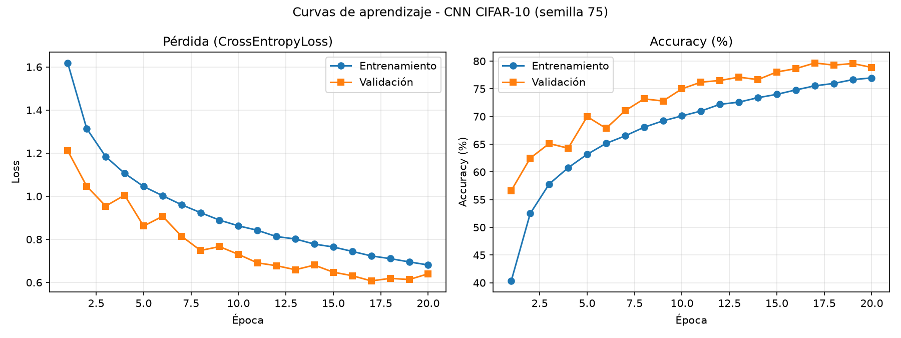
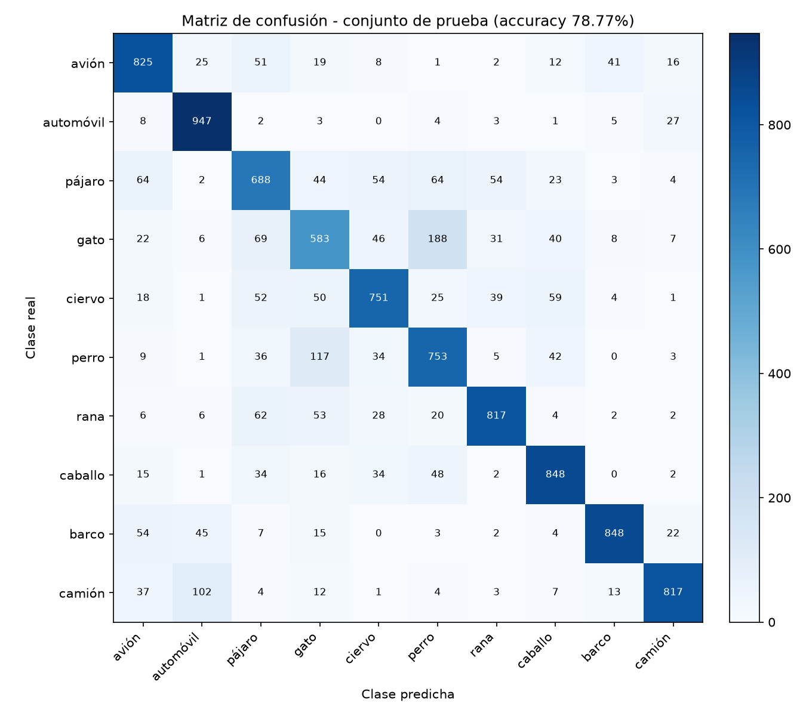

# Clasificación de imágenes CIFAR-10 mediante CNN, flujo de tensores 4D y análisis de métricas

**Universidad Andina del Cusco** - Departamento Académico de Ingeniería de Sistemas
**Curso:** Inteligencia Artificial - Evaluación de la Segunda Unidad
**Autor:** Jihuaña Mamani Marcie Brigitte
**Semilla individual:** `75` (`torch.manual_seed(75)` y `np.random.seed(75)`)

---

## 1. Estructura del repositorio

```
cnn-cifar10/
├── src/
│   ├── dataset.py      # Carga, transformaciones, partición estratificada y visualización (Pregunta 1)
│   ├── model.py        # Arquitectura CNN y validación de shapes (Pregunta 3)
│   └── train.py        # Bucle de entrenamiento, métricas y gráficas (Pregunta 4)
├── notebooks/
│   └── experiment.ipynb  # Pruebas, EDA y visualización de muestras
├── outputs/
│   ├── loss_accuracy.png
│   ├── confusion_matrix.png
│   └── README.md       # Copia de esta documentación
├── README.md
├── requirements.txt
└── .gitignore
```

## 2. Reproducibilidad y ejecución

```bash
pip install -r requirements.txt
python src/dataset.py   # descarga CIFAR-10, imprime tamaños de partición, guarda outputs/samples_grid.png
python src/model.py     # valida los shapes del forward pass con un lote simulado
python src/train.py     # entrena, evalúa y genera outputs/ y la sección de resultados de este README
```

La semilla `75` se aplica a `random`, `numpy` y `torch` (`set_seed`), a la partición estratificada
(`random_state=75`), al generador del `DataLoader` de entrenamiento (mezcla/shuffle) y a la inicialización
de los pesos de la red.

## 3. Pregunta 1 - Datos, transformaciones y partición

- **Dataset:** CIFAR-10 (60 000 imágenes RGB de 32x32 en 10 clases), descargado con `torchvision.datasets.CIFAR10`.
- **Pipeline de entrenamiento:** `RandomCrop(32, padding=4)` -> `RandomHorizontalFlip(p=0.5)` -> `ToTensor()` ->
  `Normalize(mean=(0.4914, 0.4822, 0.4465), std=(0.2470, 0.2435, 0.2616))`.
- **Pipeline de validación y prueba:** solo `ToTensor()` y `Normalize(...)`, sin aumento de datos.
- **Partición estratificada** (`train_test_split(..., stratify=targets, random_state=75)`):

| Subconjunto | Imágenes | Uso |
|---|---|---|
| Entrenamiento | 45 000 | Ajuste de pesos (con Data Augmentation) |
| Validación | 5 000 | Monitoreo por época y selección del mejor modelo |
| Prueba | 10 000 | Evaluación final independiente |

## 4. Pregunta 2 - Justificación teórica y arquitectura

### 4.1 Por qué un MLP resulta ineficiente frente a CIFAR-10

Un Perceptrón Multicapa exige una entrada vectorial, por lo que cada imagen de 32x32x3 debe aplanarse en un
vector de 3 072 valores. Esto genera tres problemas:

1. **Explosión de parámetros.** Una sola capa oculta de 512 neuronas requiere 3 072 x 512 + 512 = **1 573 376**
   parámetros. En una imagen de 224x224x3 (150 528 entradas) la misma capa superaría los 77 millones. El costo
   crece con la resolución, lo que favorece el sobreajuste y vuelve inviable el entrenamiento.
2. **Pérdida de la estructura espacial.** Al aplanar, píxeles vecinos y píxeles distantes reciben el mismo trato:
   el MLP no sabe que la vecindad 2D contiene los bordes, texturas y formas que definen un objeto.
3. **Ausencia de invariancia a la traslación.** Si un objeto se desplaza algunos píxeles, el MLP lo ve como un
   patrón completamente distinto, porque cada posición tiene pesos independientes. Tendría que aprender el mismo
   detector una vez por cada posición posible.

### 4.2 Cómo las CNN resuelven estas limitaciones

- **Conexiones locales (campos receptivos).** Cada neurona de una capa convolucional solo observa una ventana
  pequeña (3x3) de la capa anterior, y captura patrones locales (bordes, esquinas) que las capas profundas
  combinan en formas y objetos.
- **Weight Sharing (pesos compartidos).** El mismo filtro 3x3 se desliza por toda la imagen. La primera
  convolución de este proyecto usa solo 3 x 3 x 3 x 32 + 32 = **896 parámetros** para analizar los 3 072 valores
  de entrada, frente a los 1 573 376 de la capa densa equivalente.
- **Invariancia espacial.** La convolución es equivariante a la traslación (si el objeto se mueve, el mapa de
  activación se mueve con él) y el `MaxPool2d` aporta invariancia a pequeños desplazamientos, además de reducir
  la resolución espacial y el costo computacional.
- **Jerarquía de características.** Los bloques apilados aprenden desde bordes y colores (capas iniciales)
  hasta partes y objetos completos (capas profundas).

### 4.3 Especificación de la arquitectura (`src/model.py`)

| # | Capa | Configuración | Shape de salida (B = batch) | Parámetros |
|---|---|---|---|---|
| 0 | Entrada | Imagen RGB normalizada | (B, 3, 32, 32) | - |
| 1 | Conv2d | 3 -> 32, kernel 3x3, padding 1 | (B, 32, 32, 32) | 896 |
| 1 | BatchNorm2d + ReLU | 32 canales | (B, 32, 32, 32) | 64 |
| 1 | MaxPool2d | 2x2, stride 2 | (B, 32, 16, 16) | 0 |
| 2 | Conv2d | 32 -> 64, kernel 3x3, padding 1 | (B, 64, 16, 16) | 18 496 |
| 2 | BatchNorm2d + ReLU | 64 canales | (B, 64, 16, 16) | 128 |
| 2 | MaxPool2d | 2x2, stride 2 | (B, 64, 8, 8) | 0 |
| 3 | Conv2d | 64 -> 128, kernel 3x3, padding 1 | (B, 128, 8, 8) | 73 856 |
| 3 | BatchNorm2d + ReLU | 128 canales | (B, 128, 8, 8) | 256 |
| 3 | MaxPool2d | 2x2, stride 2 | (B, 128, 4, 4) | 0 |
| - | Flatten | 128 x 4 x 4 | (B, 2048) | 0 |
| 4 | Linear + ReLU + Dropout(0.5) | 2048 -> 256 | (B, 256) | 524 544 |
| 5 | Linear | 256 -> 10 (clases) | (B, 10) | 2 570 |

**Total de parámetros entrenables: 620 810.** Son tres bloques convolucionales (cada uno con `Conv2d`, `ReLU` y
`MaxPool2d`, más `BatchNorm2d` para estabilizar el entrenamiento) y dos capas densas (`Linear`) hacia las 10 clases.

## 5. Pregunta 3 - Tensores 4D y validación del forward pass

Las capas convolucionales operan sobre tensores `(Batch_Size, Channels, Height, Width)`. En `src/model.py`:

- El tamaño de entrada a la primera capa densa se calcula de forma **dinámica**:
  `flat_dim = 128 * (input_size // 2**3)**2 = 2048`, porque cada `MaxPool2d(2)` reduce H y W a la mitad.
- La capa `nn.Flatten()` conecta la salida `(B, 128, 4, 4)` con `Linear(2048, 256)`.
- La función `validate_shapes()` pasa un lote simulado `torch.randn(8, 3, 32, 32)`, **imprime en consola los shapes
  intermedios** y usa `assert` para comprobar cada uno, evitando un `Shape Mismatch`. Se ejecuta con
  `python src/model.py` y también al inicio de `python src/train.py`.

## 6. Pregunta 4 - Entrenamiento y análisis crítico

**Configuración (`src/train.py`):** `CrossEntropyLoss`, optimizador `Adam` (lr = 1e-3), 20 épocas, batch de 64.
El bucle `for epoch in range(EPOCHS):` registra en cada época el Loss y el Accuracy de entrenamiento y validación.
El mejor modelo (según accuracy de validación) se evalúa una única vez en el conjunto de prueba. Se guardan
`outputs/loss_accuracy.png` y `outputs/confusion_matrix.png`.

### Análisis crítico de las métricas (semilla 75)

<!-- RESULTADOS:START -->
**Resultados con la semilla 75** (20 épocas, Adam lr=0.001, batch=64, dispositivo: cpu):

| Métrica | Entrenamiento | Validación |
|---|---|---|
| Loss final | 0.6811 | 0.6401 |
| Accuracy final | 76.97% | 78.86% |

- Mejor época por pérdida de validación: **17** (val loss = 0.6071).
- Accuracy en el conjunto de prueba independiente (mejor modelo por val accuracy): **78.77%**.
- Clase mejor clasificada: **automóvil** (94.7%). Clase más difícil: **gato** (58.3%).

**Diagnóstico:** **Ajuste adecuado (sin overfitting ni underfitting relevantes)**. La brecha train-val es de -1.89 puntos porcentuales y la pérdida de validación se mantiene 0.033 sobre su mínimo (época 17). El accuracy de validación es incluso mayor que el de entrenamiento porque el entrenamiento se mide con Data Augmentation y Dropout activos, que dificultan las muestras; la validación se evalúa sin ellos.




<!-- RESULTADOS:END -->

### Criterio de diagnóstico

- **Overfitting:** brecha accuracy(train) - accuracy(val) mayor a 8 puntos porcentuales, o mayor a 4 con la
  pérdida de validación subiendo más de 0.10 por encima de su mínimo.
- **Underfitting:** accuracy de entrenamiento y de validación ambos por debajo de 70%.
- **Ajuste adecuado:** ninguno de los casos anteriores.
